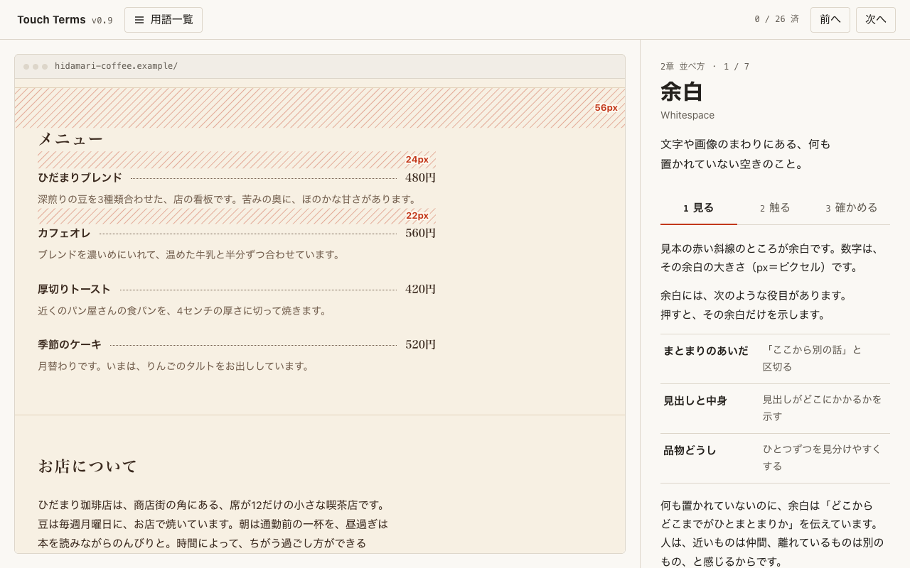
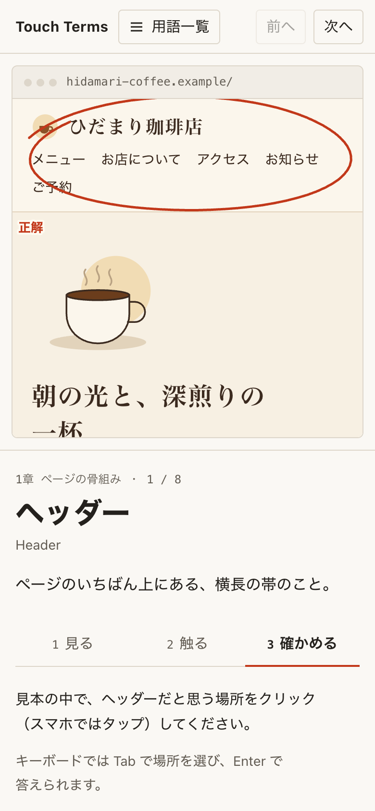
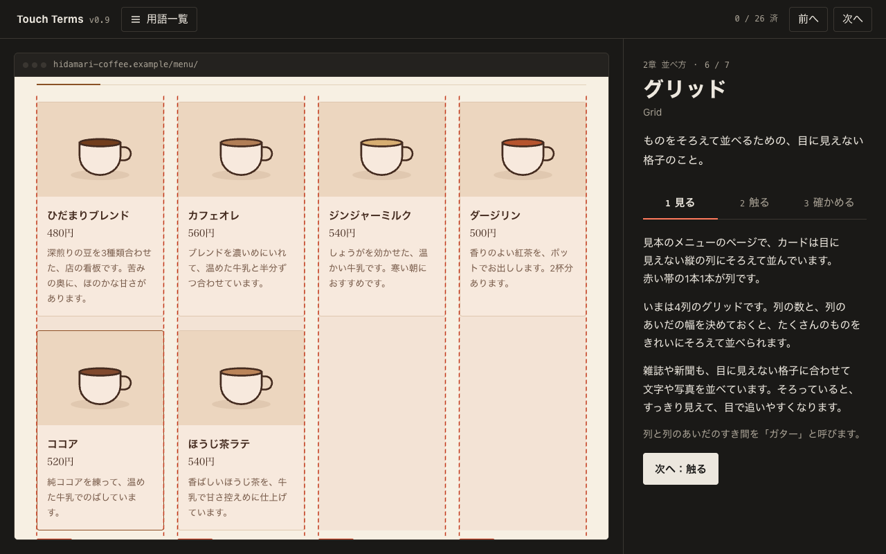

# Touch Terms

Webデザインの用語を、見本のサイトに触って覚える。

**▶ アプリを開く：https://hugesesame.github.io/touch-terms/**

Touch Terms は、Webデザインを学びはじめた人のための教材アプリです。架空のカフェ「ひだまり珈琲店」のサイトを見本にして、用語を1つずつ学びます。説明を読むだけでなく、実際のページの中で場所を確かめ、自分で変えてみて、最後に自分で見つけます。

> **いまは v0.9 です。** 日本語だけです。英語版も作る予定で、できたら英語をはじめの言語にします。

## 1つの用語の学び方

どの用語も、3つの段階で学びます。

1. **見る**：見本のサイトに、その部分を赤ペンで囲んで示します。中に何が入っているかも説明します。
2. **触る**：ヘッダーを隠す、余白を広げる、画面の幅を変えるなど、見本を自分で変えて、どうなるかを確かめます。
3. **確かめる**：短いクイズです。多くは、見本のサイトをクリックしたり操作したりして答えます。

## 学べる26語

| 章 | 用語 |
|---|---|
| 1章 ページの骨組み | ヘッダー、ナビゲーション、ヒーロー（メインビジュアル）、セクション、フッター、ファーストビュー、固定ヘッダー、パンくずリスト |
| 2章 並べ方 | 余白、マージン、パディング、行間、カード、グリッド、レスポンシブ |
| 3章 部品 | CTA、フォーム、タブ、アコーディオン、カルーセル、モーダル、ドロワー |
| 4章 動き | ホバー、スクロールアニメーション |
| 5章 ページの外側 | ファビコン、OGP |

## 使い方

ブラウザで https://hugesesame.github.io/touch-terms/ を開くだけです。インストールなどの準備はいりません。

`index.html` をダウンロードして開いても使えます。この場合は、インターネットにつながっていなくても動きます。

- パソコンの Chrome と Edge 向けに作っています。ほかのブラウザでも動きます。
- スマホの幅でも使えます。ただ、ホバーなど一部の用語は、マウスがあるほうが学びやすくなります。

## 記録について

進み具合と、最後に開いた用語は、使っている人のブラウザの中（localStorage）にだけ記録します。どこにも送りません。見本のサイトの予約フォームも見本なので、入力した内容は送られません。

## 作り

- 1枚の HTML ファイルに、JavaScript と CSS をそのまま書いています。外部のライブラリは使っていません。
- `ogp.png` と `apple-touch-icon.png` は、SNS で共有されたときの画像と、スマホのホーム画面に追加したときのアイコンです。アプリを動かすのには使いません。
- 画面に出る文章は、`index.html` の中の `TEXT` にまとめています。あとからほかの言語を足せる形です。
- ライトとダークは、パソコンの設定に合わせて切り替わります。見本のサイトは、いつも明るいままです。

## ライセンス

[MIT ライセンス](LICENSE)です。だれでも自由に使ったり、改造したり、配ったりできます。そのときは、作者の名前（hugesesame）とライセンスの文を残してください。

---

「ひだまり珈琲店」は、このアプリのためにつくった架空のお店です。住所やメニュー、ブラウザのタブに出てくるほかのサイトも、実在しません。
